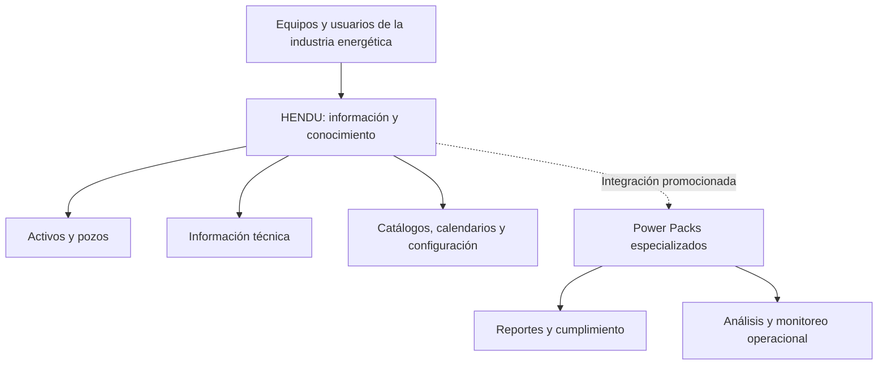

  

  
  
  
  
  

# HENDU — Plataforma empresarial de administración de información y conocimiento

**Dirección integral de producto y equipo de desarrollo · Plenumsoft Energy & Sustainability**

Durante mi etapa como **Gerente Técnico** de Plenumsoft Energy & Sustainability, **dirigí el desarrollo integral de HENDU y al equipo encargado de construirlo**. HENDU fue concebido como una plataforma empresarial para centralizar y administrar información técnica, conocimiento y procesos especializados de la industria **Oil & Gas**.

Construimos el producto con tecnologías del ecosistema Microsoft: **ASP.NET MVC, C#/.NET, Entity Framework y PostgreSQL + PostGIS**, con despliegue en **Microsoft Azure**. En esa etapa, la organización era **Microsoft Partner**.

> **Caso de estudio profesional.** Este repositorio documenta mi experiencia de dirección tecnológica y las capacidades descritas en material comercial histórico. **No contiene el código fuente de HENDU, datos de clientes, credenciales ni arquitectura interna propietaria.**

## 🎯 La necesidad empresarial

En la industria energética, la información de activos, pozos, operaciones y obligaciones regulatorias puede encontrarse distribuida entre diferentes equipos y sistemas. HENDU buscó facilitar su **consulta, organización y administración en un entorno compartido**, además de permitir que funciones especializadas complementaran el núcleo de la plataforma.

## 🧩 El producto

El folleto comercial presenta a HENDU como una **«plataforma integral para la administración de información técnica y de conocimiento para la industria Oil & Gas»**. Sus capacidades promocionadas incluían:

| Capacidad | Aplicación en HENDU |
| :--- | :--- |
| **Gestión de información** | Consulta, almacenamiento y organización de información técnica |
| **Localización de activos** | Ubicación geográfica de activos y pozos |
| **Catálogos y configuración** | Administración de información de referencia y parámetros |
| **Recordatorios y calendario** | Seguimiento de actividades y fechas relevantes |
| **Acceso multiusuario** | Uso compartido de la plataforma por diferentes perfiles de usuarios |
| **Diseño multiplataforma** | Acceso desde distintos dispositivos y entornos, según el material promocional |

## 🧱 Ecosistema modular: Power Packs

La propuesta comercial de HENDU incluía módulos especializados —denominados **Power Packs**— para ampliar el valor de la plataforma:

| Módulo | Finalidad indicada en el folleto |
| :--- | :--- |
| **C-PROD** | Apoyo al cumplimiento de entregas de reportes de producción a la **CNH** |
| **C-PERF** | Apoyo al cumplimiento de entregas de reportes de perforación a la **CNH** |
| **SASISOPA** | Procesos relacionados con normativa **ASEA/CRE** |
| **WELLDONE** | Análisis de tiempos no productivos en reparaciones de pozos |
| **NAVIC** | Monitoreo de embarcaciones en tiempo real |

**Importante:** esta tabla reproduce el alcance **promocionado** de los Power Packs; el folleto no permite confirmar por sí solo el estado de implementación o comercialización de cada módulo.

## 🛠️ Tecnologías confirmadas

| Capa o ámbito | Tecnología |
| :--- | :--- |
| Plataforma de aplicación | **ASP.NET MVC / C# / .NET** |
| Acceso y persistencia de datos | **Entity Framework** |
| Base de datos | **PostgreSQL con PostGIS** |
| Infraestructura de despliegue | **Microsoft Azure** |
| Ecosistema de desarrollo | Organización **Microsoft Partner** durante el proyecto |

Estos datos corresponden a mi experiencia como responsable del desarrollo. No publico versiones, servicios Azure concretos, topología de red ni decisiones internas de arquitectura que no estén documentadas para divulgación.

## 🔄 Visión funcional de alto nivel

*Esquema funcional simplificado para el portafolio, no una representación de la arquitectura interna del software.*

## 👤 Mi responsabilidad

Como **Gerente Técnico**, fui responsable de la **dirección integral del desarrollo del producto** y del **liderazgo del equipo de ingeniería**. Mi trabajo consistió en conducir la construcción de una plataforma empresarial modular y coordinar la entrega de la solución desde el ámbito tecnológico.

HENDU representa una etapa importante de mi experiencia en **gestión de productos tecnológicos, coordinación de equipos, software empresarial y soluciones para una industria especializada**.

## 📌 Alcance y evidencia

Este caso se apoya en el **folleto comercial de HENDU** y en mi participación directa como director del desarrollo. El material promocional describe capacidades y módulos, pero no documenta métricas de adopción, número de usuarios, ahorros cuantificados ni el estado actual del producto. Por ello, **no atribuyo resultados comerciales o indicadores no comprobados**.

Para conocer la base documental y las distinciones entre funcionalidades promocionadas y tecnologías utilizadas, consulta [Contexto, tecnologías y atribución](docs/project-context.md).

## 🔒 Propiedad intelectual

HENDU fue un producto de **Plenumsoft Energy & Sustainability**. La titularidad del software, su marca y los materiales originales corresponde a sus respectivos propietarios. Este repositorio publica únicamente una descripción profesional de alto nivel, sin redistribuir código propietario ni materiales internos.

---

<strong>Dirección de producto, liderazgo de equipos y desarrollo empresarial sobre tecnología Microsoft.</strong>

<a href="https://github.com/isaiassolis">Isaías Solís</a> · Portafolio profesional

