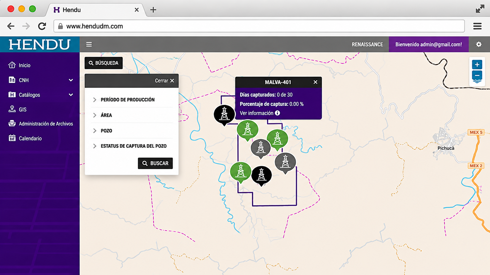
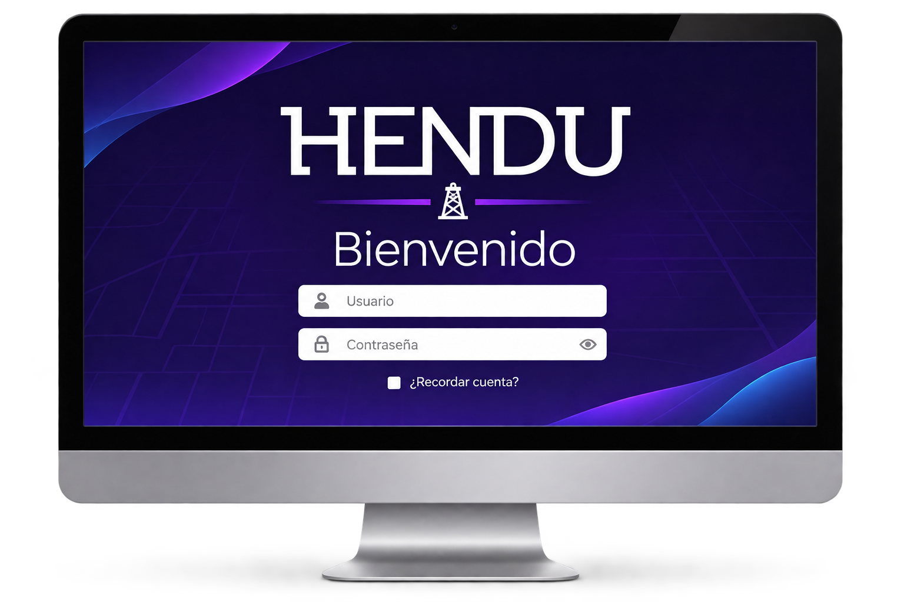
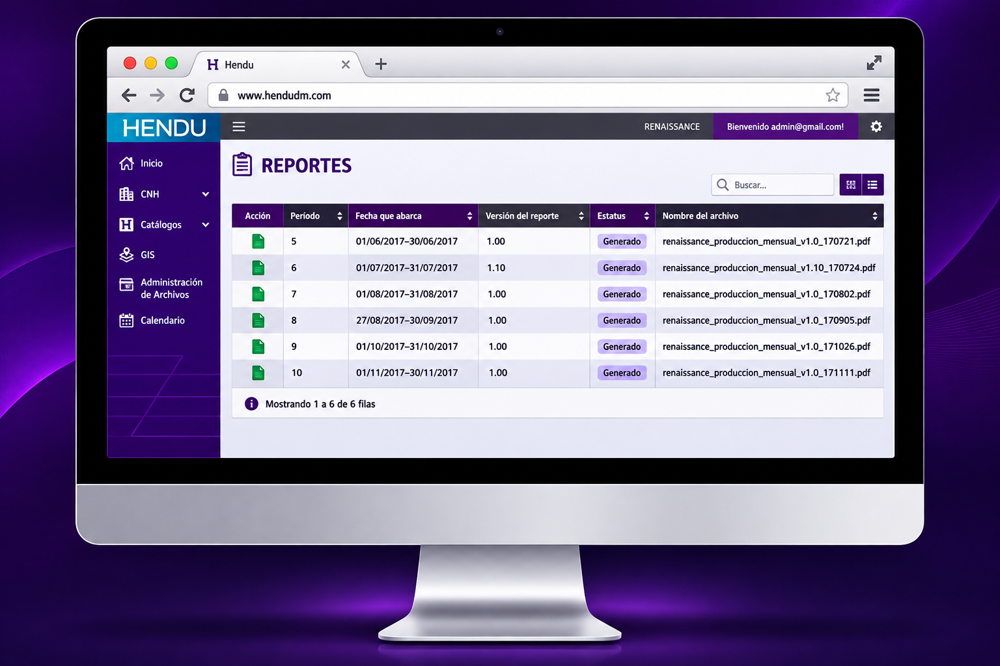
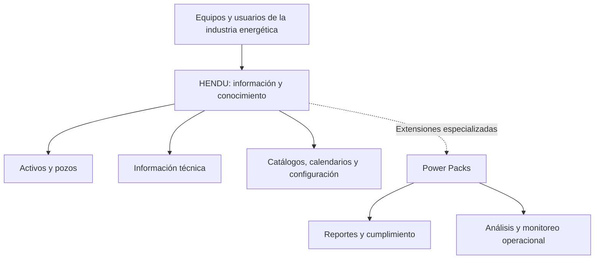

  

  
  
  
  
  

# HENDU — Plataforma empresarial de administración de información y conocimiento

**Dirección integral de producto y equipo de desarrollo · Plenumsoft Energy & Sustainability**

Durante mi etapa como **Gerente Técnico** de Plenumsoft Energy & Sustainability, **dirigí el desarrollo integral de HENDU y al equipo encargado de construirlo**. HENDU fue concebido como una plataforma empresarial para centralizar y administrar información técnica, conocimiento y procesos especializados de la industria **Oil & Gas**.

Construimos HENDU con **ASP.NET MVC, C#/.NET y Entity Framework**, utilizando **PostgreSQL con PostGIS** para la gestión de datos y capacidades geoespaciales, con despliegue en **Microsoft Azure**. En esa etapa, Plenumsoft era **Microsoft Partner**.

## 🎯 La necesidad empresarial

En la industria energética, la información de activos, pozos, operaciones y obligaciones regulatorias puede encontrarse distribuida entre diferentes equipos y sistemas. HENDU buscó facilitar su **consulta, organización y administración en un entorno compartido**, además de permitir que funciones especializadas complementaran el núcleo de la plataforma.

## 📸 Evidencia visual del producto

Las siguientes imágenes corresponden a interfaces históricas de HENDU y se incluyen para documentar las capacidades del producto. No constituyen una demostración activa ni implican disponibilidad del software.

### Visualización geoespacial (GIS)

*Vista cartográfica de activos con filtros de búsqueda e indicadores operativos.*

### Acceso a la plataforma

*Presentación visual del acceso a HENDU en su interfaz histórica.*

### Gestión documental vinculada a pozos

*Interfaz de consulta y administración de documentos vinculados con información técnica de pozos.*

> **Nota:** Material visual histórico compartido con fines de portafolio profesional. HENDU y sus materiales originales son propiedad de Plenumsoft Energy & Sustainability.

## 🧩 El producto

HENDU integraba herramientas para administrar información técnica y conocimiento en la industria **Oil & Gas**. Entre sus capacidades se encontraban:

| Capacidad | Aplicación en HENDU |
| :--- | :--- |
| **Gestión de información** | Consulta, almacenamiento y organización de información técnica |
| **Localización de activos** | Ubicación geográfica de activos y pozos |
| **Catálogos y configuración** | Administración de información de referencia y parámetros |
| **Recordatorios y calendario** | Seguimiento de actividades y fechas relevantes |
| **Acceso multiusuario** | Uso compartido de la plataforma por diferentes perfiles de usuarios |
| **Diseño multiplataforma** | Acceso a la solución desde distintos dispositivos |

## 🧱 Ecosistema modular: Power Packs

La arquitectura funcional de HENDU contemplaba **Power Packs**, extensiones especializadas para procesos operativos y regulatorios:

| Módulo | Función |
| :--- | :--- |
| **C-PROD** | Apoyo al cumplimiento de entregas de reportes de producción a la **CNH** |
| **C-PERF** | Apoyo al cumplimiento de entregas de reportes de perforación a la **CNH** |
| **SASISOPA** | Procesos relacionados con normativa **ASEA/CRE** |
| **WELLDONE** | Análisis de tiempos no productivos en reparaciones de pozos |
| **NAVIC** | Monitoreo de embarcaciones en tiempo real |

**C-PROD** contaba con funcionalidades de configuración de periodos, captura diaria de producción y generación de reportes. Los demás Power Packs formaban parte de la línea de soluciones presentadas por Plenumsoft, con distintas etapas de desarrollo.

## 🛠️ Tecnologías confirmadas

| Capa o ámbito | Tecnología |
| :--- | :--- |
| Plataforma de aplicación | **ASP.NET MVC / C# / .NET** |
| Acceso y persistencia de datos | **Entity Framework** |
| Base de datos | **PostgreSQL con PostGIS** |
| Infraestructura de despliegue | **Microsoft Azure** |
| Ecosistema de desarrollo | Organización **Microsoft Partner** durante el proyecto |

## 🔄 Visión funcional de alto nivel

*Vista funcional de los principales componentes del producto.*

## 👤 Mi responsabilidad

Como **Gerente Técnico**, fui responsable de la **dirección integral del desarrollo del producto** y del **liderazgo del equipo de ingeniería**. Mi trabajo consistió en conducir la construcción de una plataforma empresarial modular y coordinar la entrega de la solución desde el ámbito tecnológico.

HENDU representa una etapa importante de mi experiencia en **gestión de productos tecnológicos, coordinación de equipos, software empresarial y soluciones para una industria especializada**.

[Conocer más sobre la arquitectura funcional y mi participación](docs/project-context.md).

## 🔒 Propiedad intelectual

HENDU fue un producto de **Plenumsoft Energy & Sustainability**. La titularidad del software, su marca y los materiales originales corresponde a sus respectivos propietarios. Este repositorio presenta mi participación profesional y la visión funcional del producto, sin incluir su código fuente.

---

<strong>Dirección de producto, liderazgo de equipos y desarrollo empresarial sobre tecnología Microsoft.</strong>

<a href="https://github.com/isaiassolis">Isaías Solís</a> · Portafolio profesional

