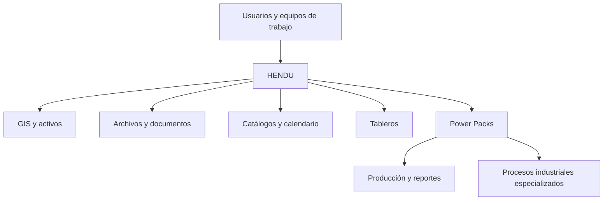

  

  
  
  
  
  

# HENDU — Plataforma empresarial de información y conocimiento para Oil & Gas

**Dirección de producto y liderazgo del equipo de ingeniería · Plenumsoft Energy & Sustainability**

Durante mi etapa como **Gerente Técnico en Plenumsoft Energy & Sustainability**, dirigí el desarrollo integral de **HENDU** y al equipo de ingeniería responsable de construirlo.

Creamos una plataforma empresarial para organizar información técnica y conocimiento de la industria de hidrocarburos. HENDU reunía en un mismo entorno herramientas para consultar activos y pozos, administrar documentos, mantener catálogos operativos y dar seguimiento a actividades, con la posibilidad de ampliar sus funciones mediante módulos especializados.

## El desafío

Las operaciones de la industria energética generan información técnica distribuida entre pozos, campos, instalaciones, documentos y distintos equipos de trabajo. Consultarla y mantenerla organizada exige conectar los datos con los activos y procesos a los que pertenecen.

Con HENDU buscamos facilitar ese trabajo: **centralizar la información, hacerla accesible desde una interfaz común y aprovechar su contexto geográfico y operativo**.

## La plataforma

Organizamos HENDU alrededor de un conjunto de herramientas complementarias:

| Componente | Funcionalidad |
| :--- | :--- |
| **GIS** | Consulta georreferenciada de áreas, campos, pozos y activos; búsqueda mediante filtros. |
| **Archivos** | Carga, consulta y organización de documentos vinculados a activos. |
| **Catálogos** | Administración de datos de referencia, pozos, campos, áreas y otros elementos operativos. |
| **Calendario** | Seguimiento de actividades, recordatorios y notas. |
| **Dashboard** | Visualización de información e indicadores mediante tableros. |
| **Usuarios** | Acceso compartido para diferentes perfiles de trabajo. |

### Capturas de HENDU

Estas pantallas muestran parte de la interfaz que desarrollamos.

#### Visualización geográfica de activos

*Consulta de pozos y activos desde una vista georreferenciada.*

#### Acceso a la plataforma

*Interfaz de entrada al sistema.*

#### Administración documental

*Consulta y organización de archivos vinculados con la información técnica de pozos.*

## Una plataforma modular: Power Packs

Diseñamos HENDU para extender su funcionalidad con componentes especializados llamados **Power Packs**.

Uno de ellos fue **C-PROD**, orientado a la administración de información de producción y la preparación de reportes para la **Comisión Nacional de Hidrocarburos (CNH)**. Incluía herramientas para configurar periodos de entrega, registrar producción diaria y generar reportes.

La línea de soluciones también contemplaba otros Power Packs:

| Power Pack | Área de aplicación |
| :--- | :--- |
| **C-PERF** | Información y reportes de perforación. |
| **SASISOPA** | Procesos de seguridad industrial y protección ambiental. |
| **WELLDONE** | Análisis de tiempos no productivos en trabajos sobre pozos. |
| **NAVIC** | Monitoreo de embarcaciones. |

Estos componentes formaban parte de la evolución y oferta modular del producto, en distintas etapas de desarrollo.

**Regulation System SASISOPA** también se desarrolló como un **producto independiente**, capaz de intercambiar información con HENDU. [Conocer Regulation System SASISOPA](https://github.com/isaiassolis/regulation-system-sasisopa).

## Tecnología

Construimos HENDU combinando tecnologías de desarrollo web empresarial, persistencia de datos, información geoespacial e infraestructura en la nube.

| Componente | Tecnología |
| :--- | :--- |
| Aplicación web | **ASP.NET MVC · C# · .NET** |
| Acceso a datos | **Entity Framework** |
| Base de datos | **PostgreSQL** |
| Información geoespacial | **PostGIS** |
| Infraestructura | **Microsoft Azure** |

Durante esta etapa, Plenumsoft Energy & Sustainability era **Microsoft Partner**.

## Mi participación

Como **Gerente Técnico**, asumí la **dirección integral del desarrollo de HENDU** y el **liderazgo del equipo de ingeniería**.

Mi responsabilidad fue conducir la construcción del producto desde el ámbito tecnológico, coordinar el trabajo del equipo y mantener una visión integral de la plataforma y sus módulos.

HENDU representa una parte importante de mi experiencia en **dirección de productos de software, liderazgo técnico, desarrollo empresarial e integración de información geoespacial**.

## Arquitectura funcional

*Vista general de las funciones de la plataforma.*

## Sobre el proyecto

HENDU es un producto de **Plenumsoft Energy & Sustainability**. Este repositorio presenta el trabajo que dirigí y las características principales de la plataforma, sin publicar el código fuente ni información de clientes.

[Más detalles sobre la plataforma y mi participación](docs/project-context.md).

---

<strong>Dirección tecnológica · Liderazgo de equipos · Desarrollo de software empresarial</strong>

<a href="https://github.com/isaiassolis">Volver a mi portafolio profesional</a>

